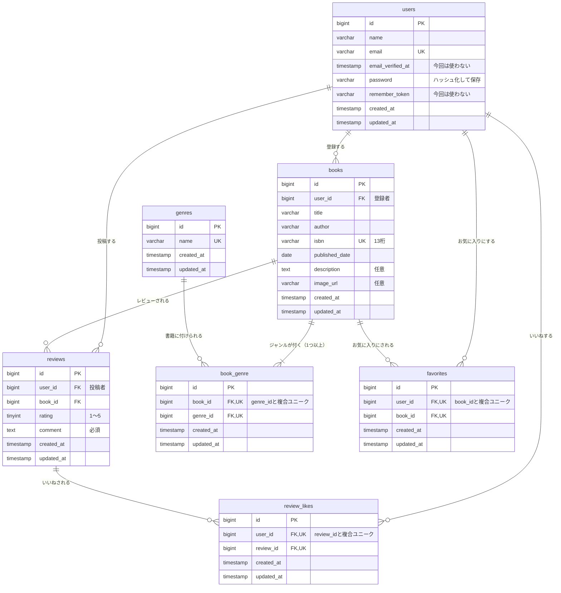

# BookShelf

書籍レビューアプリ（Laravel 10・PHP 8.5・MySQL 8.4）。Blade の Web 画面と外部向けの公開API（JSON）を持つ。
設計書は [`docs/`](docs/) にある。実装と設計書が食い違ったら設計書を正とする。

- [ER図](#er図)
- [公開API のレスポンス構造](#公開api-のレスポンス構造)

## ER図

アプリのテーブルとそのつながり（基本機能の範囲）。
列の型・制約は [`docs/table-definitions.md`](docs/table-definitions.md) を参照。
つながりの詳細は [`docs/er-diagram.md`](docs/er-diagram.md) を参照。



- 書籍を削除すると、そのレビュー・お気に入り・ジャンルの紐付け・レビューへのいいねも一緒に消える（cascade）。
- ユーザーは削除しない。ジャンルは書籍が紐付いていると削除できない。
- 同じユーザーが同じ書籍に何件でもレビューを書ける。

## 公開API のレスポンス構造

ベース URL は `http://localhost/api/v1`。認証なし。エラーも含めて JSON で返す（日本語はエスケープしない）。
入力・エラーの詳細は [`docs/api-spec.md`](docs/api-spec.md) を参照。

| メソッド | パス            | 説明               | 成功時 |
| -------- | --------------- | ------------------ | ------ |
| GET      | `/books`        | 書籍一覧を取得する | 200    |
| GET      | `/books/{book}` | 書籍詳細を取得する | 200    |
| POST     | `/books`        | 書籍を新規登録する | 201    |
| PUT      | `/books/{book}` | 書籍を更新する     | 200    |
| DELETE   | `/books/{book}` | 書籍を削除する     | 204    |

### 書籍一覧（`GET /books`）

Laravel 標準のページ分け（`data`・`links`・`meta`）。クエリは `keyword`・`genre_id`・`page`・`per_page`（既定 20・最大 100）。新しい順。

```json
{
  "data": [
    {
      "id": 9,
      "title": "火花",
      "author": "又吉直樹",
      "isbn": "9784163902302",
      "published_date": "2015-03-11",
      "description": "売れない芸人の徳永と、先輩芸人の神谷の日々を描いた小説。",
      "image_url": null,
      "user": { "id": 1, "name": "山田太郎" },
      "genres": [{ "id": 1, "name": "小説" }],
      "reviews_avg_rating": 4.3,
      "reviews_count": 3,
      "created_at": "2026-11-01T01:00:00.000000Z",
      "updated_at": "2026-11-01T01:00:00.000000Z"
    }
  ],
  "links": { "first": "…?page=1", "last": "…?page=2", "prev": null, "next": "…?page=2" },
  "meta": {
    "current_page": 1,
    "from": 1,
    "last_page": 2,
    "links": [
      { "url": null, "label": "&laquo; Previous", "active": false },
      { "url": "…?page=1", "label": "1", "active": true },
      { "url": "…?page=2", "label": "2", "active": false },
      { "url": "…?page=2", "label": "Next &raquo;", "active": false }
    ],
    "path": "…/books",
    "per_page": 20,
    "to": 1,
    "total": 2
  }
}
```

- `links`：最初・最後・前・次のページの URL（前や次が無いときは `null`）。`next` をたどれば続きが読める。`keyword`・`genre_id`・`per_page` の条件は、どの URL にも引き継がれる。
- `meta.links`：ページ番号のボタンの一覧（`url`・`label`・`active`）。先頭が「前へ」で末尾が「次へ」。`active` が `true` のものが今のページ。
- `label` は Laravel 標準のまま。英語（`Previous`・`Next`）と HTML の記号（`&laquo;`・`&raquo;`）がつく。

### 書籍詳細・登録・更新（`GET`・`POST`・`PUT`）

`data` の中に 1 冊分が入る。項目は書籍一覧と同じで、これに `reviews`（新しい順。無ければ `[]`）が加わる。一覧には `reviews` は入らない。
登録は 201、更新は 200。どちらも詳細と同じ形。

```json
{
  "data": {
    "id": 2,
    "title": "人を動かす",
    "author": "D・カーネギー",
    "isbn": "9784422100524",
    "published_date": "1936-10-01",
    "description": "人間関係の原則をまとめた自己啓発書。",
    "image_url": null,
    "user": { "id": 1, "name": "山田太郎" },
    "genres": [
      { "id": 2, "name": "ビジネス" },
      { "id": 4, "name": "自己啓発" }
    ],
    "reviews_avg_rating": 5,
    "reviews_count": 1,
    "reviews": [
      {
        "id": 5,
        "rating": 5,
        "comment": "人付き合いの考え方が変わった。",
        "user": { "id": 2, "name": "鈴木花子" },
        "created_at": "2026-11-01T01:00:00.000000Z"
      }
    ],
    "created_at": "2026-11-01T01:00:00.000000Z",
    "updated_at": "2026-11-01T01:00:00.000000Z"
  }
}
```

| 項目                 | 型            | 内容                                                                 |
| -------------------- | ------------- | -------------------------------------------------------------------- |
| `isbn`               | 文字列        | ハイフン無しの 13 桁。先頭の 0 が消えないよう文字列                  |
| `description`        | 文字列 / null | 未入力なら `null`（`image_url` も同じ）                              |
| `user`               | オブジェクト  | 登録者（レビューでは投稿者）。`id` と `name` だけ。メールは返さない  |
| `genres`             | 配列          | 各要素は `id` と `name`。入力（POST・PUT）ではジャンル ID の配列    |
| `reviews_avg_rating` | 数値 / null   | 小数第 1 位に丸める。レビューが無ければ `null`                      |
| `reviews_count`      | 整数          | レビュー件数                                                         |
| `created_at` 等      | 文字列        | ISO 8601（UTC）                                                      |

### 書籍削除（`DELETE /books/{book}`）

204 で本文なし。

### エラー

どのエラーも `error` を返す。入力エラー（422）だけ項目ごとのメッセージを `errors` に入れる。

| ステータス | 場合                                     | 本文                |
| ---------- | ---------------------------------------- | ------------------- |
| 404        | その ID の書籍が無い、または無いパス     | `error`           |
| 405        | パスはあるがメソッドが違う               | `error`           |
| 422        | 入力がルールに合わない                   | `error`・`errors` |
| 429        | 回数の制限（1 分に 60 回）を超えた       | `error`           |
| 500        | サーバーの中で予期しないエラーが起きた   | `error`           |

```json
{
  "error": "登録者が存在しません。 （ほか2件のエラー）",
  "errors": {
    "user_id": ["登録者が存在しません。"],
    "title": ["タイトルは必須です。"],
    "isbn": ["ISBNは13桁の数字で入力してください。"]
  }
}
```
