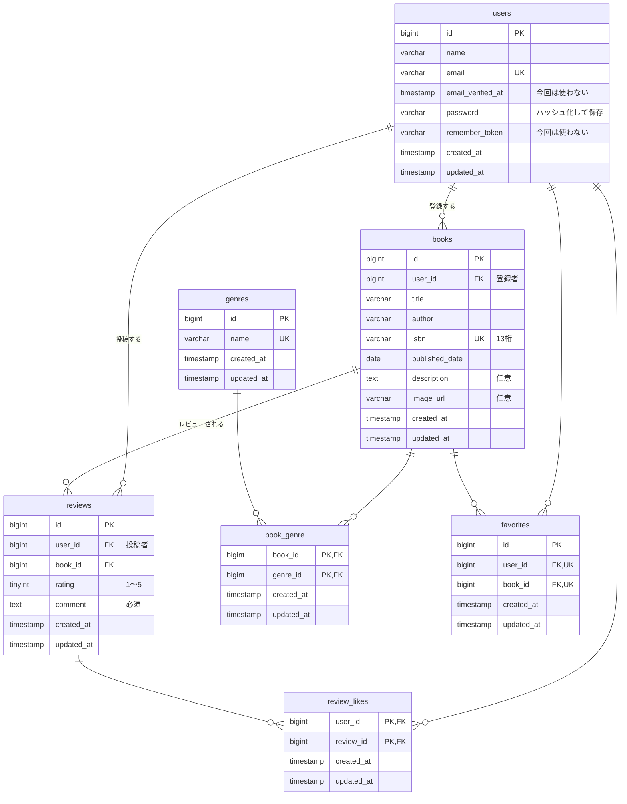

# BookShelf

書籍レビューアプリ（Laravel 10・PHP 8.5・MySQL 8.4）。Blade の Web 画面と、外部向けの公開API（JSON）を持つ。
設計書は [`docs/`](docs/) にある。実装と設計書が食い違ったときは、設計書を正とする。

- [ER図](#er図)
- [公開API のレスポンス構造](#公開api-のレスポンス構造)

## ER図

アプリのテーブルと、そのつながり（基本機能の範囲）。列の型・制約は [`docs/table-definitions.md`](docs/table-definitions.md)、つながりの詳細は [`docs/er-diagram.md`](docs/er-diagram.md) を参照。



- 書籍を削除すると、そのレビュー・お気に入り・ジャンルの紐付け、レビューへのいいねも一緒に消える（cascade）。
- ユーザーは削除しない。ジャンルは、書籍が紐付いていると削除できない。
- 同じユーザーが同じ書籍に、何件でもレビューを書ける。

## 公開API のレスポンス構造

ベース URL は `http://localhost/api/v1`。認証なし。レスポンスは、エラーも含めて JSON（日本語はエスケープしない）。
入力・エラーの詳細は [`docs/api-spec.md`](docs/api-spec.md) を参照。

| メソッド | パス            | 説明               | 成功時 |
| -------- | --------------- | ------------------ | ------ |
| GET      | `/books`        | 書籍一覧を取得する | 200    |
| GET      | `/books/{book}` | 書籍詳細を取得する | 200    |
| POST     | `/books`        | 書籍を新規登録する | 201    |
| PUT      | `/books/{book}` | 書籍を更新する     | 200    |
| DELETE   | `/books/{book}` | 書籍を削除する     | 204    |

### 書籍一覧（`GET /books`）

Laravel 標準のページ分け（`data`・`links`・`meta`）。クエリは `keyword`・`genre_id`・`page`・`per_page`（既定 20、最大 100）。新しい順。

```json
{
  "data": [
    {
      "id": 9,
      "title": "火花",
      "author": "又吉直樹",
      "isbn": "9784163902302",
      "published_date": "2015-03-11",
      "description": "売れない芸人の徳永と、先輩芸人の神谷の日々を描いた小説。",
      "image_url": null,
      "user": { "id": 1, "name": "山田太郎" },
      "genres": [{ "id": 1, "name": "小説" }],
      "reviews_avg_rating": 4.3,
      "reviews_count": 3,
      "created_at": "2026-11-01T01:00:00.000000Z",
      "updated_at": "2026-11-01T01:00:00.000000Z"
    }
  ],
  "links": { "first": "…?page=1", "last": "…?page=2", "prev": null, "next": "…?page=2" },
  "meta": { "current_page": 1, "from": 1, "last_page": 2, "path": "…/books", "per_page": 20, "to": 1, "total": 2 }
}
```

### 書籍詳細・登録・更新（`GET`・`POST`・`PUT`）

`data` の中に 1 冊分。一覧の項目に、`reviews`（新しい順。無ければ `[]`）が加わる。登録は 201、更新は 200 で、どちらも詳細と同じ形。

```json
{
  "data": {
    "id": 2,
    "title": "人を動かす",
    "author": "D・カーネギー",
    "isbn": "9784422100524",
    "published_date": "1936-10-01",
    "description": "人間関係の原則をまとめた自己啓発書。",
    "image_url": null,
    "user": { "id": 1, "name": "山田太郎" },
    "genres": [
      { "id": 2, "name": "ビジネス" },
      { "id": 4, "name": "自己啓発" }
    ],
    "reviews_avg_rating": 5,
    "reviews_count": 1,
    "reviews": [
      {
        "id": 5,
        "rating": 5,
        "comment": "人付き合いの考え方が変わった。",
        "user": { "id": 2, "name": "鈴木花子" },
        "created_at": "2026-11-01T01:00:00.000000Z"
      }
    ],
    "created_at": "2026-11-01T01:00:00.000000Z",
    "updated_at": "2026-11-01T01:00:00.000000Z"
  }
}
```

| 項目                 | 型            | 内容                                                                 |
| -------------------- | ------------- | -------------------------------------------------------------------- |
| `isbn`               | 文字列        | ハイフン無しの 13 桁。先頭の 0 が消えないよう文字列                  |
| `description`        | 文字列 / null | 未入力なら `null`（`image_url` も同じ）                              |
| `user`               | オブジェクト  | 登録者（レビューでは投稿者）。`id` と `name` だけ。メールは返さない  |
| `genres`             | 配列          | 各要素は `id` と `name`。入力（POST・PUT）ではジャンル ID の配列    |
| `reviews_avg_rating` | 数値 / null   | 小数第 1 位に丸める。レビューが無ければ `null`                      |
| `reviews_count`      | 整数          | レビュー件数                                                         |
| `created_at` 等      | 文字列        | ISO 8601（UTC）                                                      |

### 書籍削除（`DELETE /books/{book}`）

204 で本文なし。

### エラー

どのエラーも `message` を返す。入力エラー（422）だけ、項目ごとのメッセージを `errors` に入れる。

| ステータス | 場合                                     | 本文                |
| ---------- | ---------------------------------------- | ------------------- |
| 404        | その ID の書籍が無い、または無いパス     | `message`           |
| 405        | パスはあるが、メソッドが違う             | `message`           |
| 422        | 入力がルールに合わない                   | `message`・`errors` |
| 429        | 回数の制限（1 分に 60 回）を超えた       | `message`           |
| 500        | サーバーの中で予期しないエラーが起きた   | `message`           |

```json
{
  "message": "登録者が存在しません。 （ほか2件のエラー）",
  "errors": {
    "user_id": ["登録者が存在しません。"],
    "title": ["タイトルは必須です。"],
    "isbn": ["ISBNは13桁の数字で入力してください。"]
  }
}
```

---

<p align="center"><a href="https://laravel.com" target="_blank"></a></p>

<p align="center">
<a href="https://github.com/laravel/framework/actions"></a>
<a href="https://packagist.org/packages/laravel/framework"></a>
<a href="https://packagist.org/packages/laravel/framework"></a>
<a href="https://packagist.org/packages/laravel/framework"></a>
</p>

## About Laravel

Laravel is a web application framework with expressive, elegant syntax. We believe development must be an enjoyable and creative experience to be truly fulfilling. Laravel takes the pain out of development by easing common tasks used in many web projects, such as:

- [Simple, fast routing engine](https://laravel.com/docs/routing).
- [Powerful dependency injection container](https://laravel.com/docs/container).
- Multiple back-ends for [session](https://laravel.com/docs/session) and [cache](https://laravel.com/docs/cache) storage.
- Expressive, intuitive [database ORM](https://laravel.com/docs/eloquent).
- Database agnostic [schema migrations](https://laravel.com/docs/migrations).
- [Robust background job processing](https://laravel.com/docs/queues).
- [Real-time event broadcasting](https://laravel.com/docs/broadcasting).

Laravel is accessible, powerful, and provides tools required for large, robust applications.

## Learning Laravel

Laravel has the most extensive and thorough [documentation](https://laravel.com/docs) and video tutorial library of all modern web application frameworks, making it a breeze to get started with the framework.

You may also try the [Laravel Bootcamp](https://bootcamp.laravel.com), where you will be guided through building a modern Laravel application from scratch.

If you don't feel like reading, [Laracasts](https://laracasts.com) can help. Laracasts contains thousands of video tutorials on a range of topics including Laravel, modern PHP, unit testing, and JavaScript. Boost your skills by digging into our comprehensive video library.

## Laravel Sponsors

We would like to extend our thanks to the following sponsors for funding Laravel development. If you are interested in becoming a sponsor, please visit the [Laravel Partners program](https://partners.laravel.com).

### Premium Partners

- **[Vehikl](https://vehikl.com/)**
- **[Tighten Co.](https://tighten.co)**
- **[WebReinvent](https://webreinvent.com/)**
- **[Kirschbaum Development Group](https://kirschbaumdevelopment.com)**
- **[64 Robots](https://64robots.com)**
- **[Curotec](https://www.curotec.com/services/technologies/laravel/)**
- **[Cyber-Duck](https://cyber-duck.co.uk)**
- **[DevSquad](https://devsquad.com/hire-laravel-developers)**
- **[Jump24](https://jump24.co.uk)**
- **[Redberry](https://redberry.international/laravel/)**
- **[Active Logic](https://activelogic.com)**
- **[byte5](https://byte5.de)**
- **[OP.GG](https://op.gg)**

## Contributing

Thank you for considering contributing to the Laravel framework! The contribution guide can be found in the [Laravel documentation](https://laravel.com/docs/contributions).

## Code of Conduct

In order to ensure that the Laravel community is welcoming to all, please review and abide by the [Code of Conduct](https://laravel.com/docs/contributions#code-of-conduct).

## Security Vulnerabilities

If you discover a security vulnerability within Laravel, please send an e-mail to Taylor Otwell via [taylor@laravel.com](mailto:taylor@laravel.com). All security vulnerabilities will be promptly addressed.

## License

The Laravel framework is open-sourced software licensed under the [MIT license](https://opensource.org/licenses/MIT).
