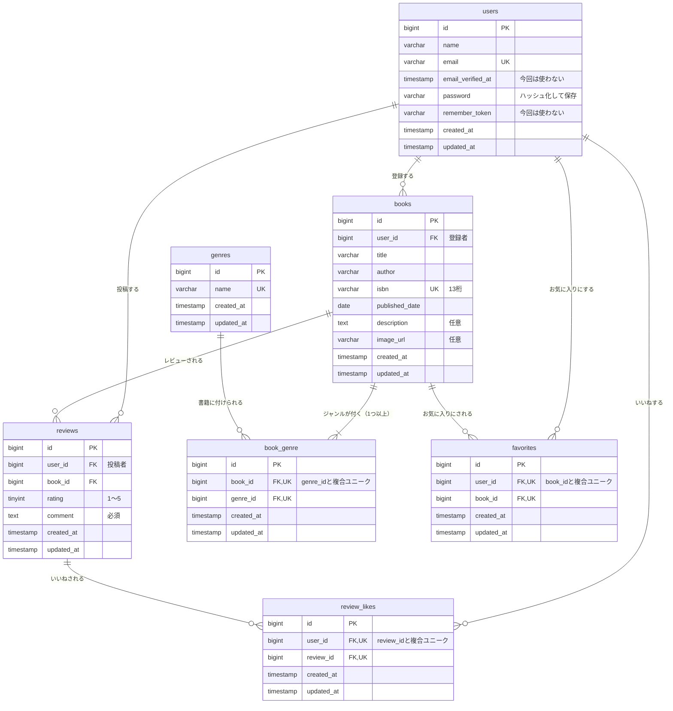

# BookShelf 書籍レビューアプリ

読んだ本を登録して、レビューを共有するためのアプリ。Blade の Web 画面と、外部向けの公開API（JSON）を持つ。
設計書は [`docs/`](docs/) にある。実装と設計書が食い違ったら設計書を正とする。

- [作成者](#作成者)
- [使用技術](#使用技術)
- [開発環境URL](#開発環境url)
- [動作環境](#動作環境)
- [環境構築手順](#環境構築手順)
- [テスト](#テスト)
- [機能一覧](#機能一覧)
- [ER図](#er図)
- [APIエンドポイント一覧](#apiエンドポイント一覧)
- [開発ルールの例外](#開発ルールの例外)

## 作成者

赤池美優

## 使用技術

- **言語**：PHP 8.5
- **フレームワーク**：Laravel 10
- **認証**：Laravel Fortify（Web 画面のセッション認証）
- **データベース**：MySQL 8.4
- **データベース管理ツール**：phpMyAdmin
- **フロントエンド**：Vite 5・Tailwind CSS 3・Alpine.js 3
- **開発環境**：Docker（Laravel Sail）
- **テストツール**：PHPUnit 10

## 開発環境URL

- アプリ：<http://localhost>
- phpMyAdmin：<http://localhost:8080>

## 動作環境

Windows 上の WSL（Ubuntu）で開発している。PHP・MySQL・Node.js は Docker のコンテナで動くため、手元に必要なのは Git と Docker。

## 環境構築手順

コマンドは、Docker を起動した状態で、WSL（Ubuntu）のターミナルで実行する。

1. **リポジトリをクローンする**

    ```bash
    git clone https://github.com/miyori-knzk/bookshelf-app.git
    cd bookshelf-app
    ```

2. **`.env` を作る**

    ```bash
    cp .env.example .env
    ```

3. **`.env` のデータベースの設定を書き換える**

    `.env.example` のままでは MySQL のコンテナが起動しないため、次の値にする。

    ```
    DB_CONNECTION=mysql
    DB_HOST=mysql
    DB_PORT=3306
    DB_DATABASE=laravel
    DB_USERNAME=sail
    DB_PASSWORD=password
    ```

4. **Composer の依存パッケージを入れる**

    ```bash
    docker run --rm \
        -u "$(id -u):$(id -g)" \
        -v "$(pwd):/var/www/html" \
        -w /var/www/html \
        -e COMPOSER_CACHE_DIR=/tmp/composer_cache \
        laravelsail/php84-composer:latest \
        composer install --ignore-platform-reqs
    ```

5. **コンテナを起動する**

    ```bash
    ./vendor/bin/sail up -d
    ```

    初回はイメージの作成に時間がかかる。

6. **アプリケーションキーを作る**

    ```bash
    ./vendor/bin/sail artisan key:generate
    ```

7. **テーブルを作り、初期データを入れる**

    ```bash
    ./vendor/bin/sail artisan migrate --seed
    ```

    接続エラーになったときは、MySQL の起動が終わっていないので、少し待ってから実行し直す。

8. **画面の CSS と JavaScript をビルドする**

    ```bash
    ./vendor/bin/sail npm install
    ./vendor/bin/sail npm run build
    ```

9. **ログインする**

    <http://localhost/login> を開き、次のユーザーでログインする。

    - メールアドレス：`yamada@example.com`
    - パスワード：`password`

    ほかに `suzuki@example.com`・`tanaka@example.com`・`sato@example.com`・`takahashi@example.com` も使える（パスワードはどれも `password`）。

## テスト

コンテナを起動してから実行する。

```bash
./vendor/bin/sail up -d
./vendor/bin/sail test
```

テストは MySQL の `testing` データベースで動く（`phpunit.xml`）。普段使う `laravel` データベースのデータは消えない。`.env.testing` は作らなくてよい。

- `sail artisan config:cache` を実行した状態でテストすると、`testing` ではなく `laravel` が対象になり、データが消える。先に `./vendor/bin/sail artisan config:clear` を実行する。
- `testing` データベースは、MySQL のボリュームを最初に作るときにだけ作られる。「Unknown database 'testing'」で失敗するときは、次のコマンドで作る。

    ```bash
    ./vendor/bin/sail exec mysql mysql -uroot -ppassword \
        -e 'CREATE DATABASE IF NOT EXISTS testing; GRANT ALL PRIVILEGES ON `testing%`.* TO "sail"@"%";'
    ```

## 機能一覧

詳しくは [`docs/features.md`](docs/features.md) を参照。

| 分類                   | 機能                                                                 | ログイン |
| ---------------------- | -------------------------------------------------------------------- | -------- |
| 書籍                   | 一覧・詳細                                                           | 不要     |
|                        | 登録                                                                 | 必要     |
|                        | 編集・削除（登録した本人だけ）                                       | 必要     |
| ジャンル               | 一覧・詳細・登録・編集・削除（書籍が紐付いていると削除できない）     | 必要     |
| レビュー               | 投稿                                                                 | 必要     |
|                        | 編集・削除（投稿した本人だけ）                                       | 必要     |
| いいね・お気に入り     | レビューへのいいね、書籍のお気に入り登録・解除、お気に入り一覧       | 必要     |
| ランキング             | 平均評価の TOP10                                                     | 不要     |
| 認証                   | 会員登録・ログイン                                                   | 不要     |
|                        | ログアウト                                                           | 必要     |
| 公開API                | 書籍の一覧・詳細・登録・更新・削除                                   | 不要     |

## ER図

アプリのテーブルとそのつながり（基本機能の範囲）。
列の型・制約は [`docs/table-definitions.md`](docs/table-definitions.md) を参照。
つながりの詳細は [`docs/er-diagram.md`](docs/er-diagram.md) を参照。



- 書籍を削除すると、そのレビュー・お気に入り・ジャンルの紐付け・レビューへのいいねも一緒に消える（cascade）。
- ユーザーは削除しない。ジャンルは書籍が紐付いていると削除できない。
- 同じユーザーが同じ書籍に何件でもレビューを書ける。

## APIエンドポイント一覧

ベース URL は `http://localhost/api/v1`。認証なし。エラーも含めて JSON で返す（日本語はエスケープしない）。
入力・エラーの詳細は [`docs/api-spec.md`](docs/api-spec.md) を参照。

| メソッド | パス            | 説明               | 成功時 |
| -------- | --------------- | ------------------ | ------ |
| GET      | `/books`        | 書籍一覧を取得する | 200    |
| GET      | `/books/{book}` | 書籍詳細を取得する | 200    |
| POST     | `/books`        | 書籍を新規登録する | 201    |
| PUT      | `/books/{book}` | 書籍を更新する     | 200    |
| DELETE   | `/books/{book}` | 書籍を削除する     | 204    |

更新は `PATCH` でも受け付ける。入力チェックは `PUT` と同じで、すべての項目を送る。

### リクエストパラメーター

POST・PUT の本文は JSON で送る（`Content-Type: application/json`）。`Accept: application/json` も付けることを勧める。

#### パス（`GET`・`PUT`・`DELETE /books/{book}`）

| 名前   | 型   | 必須 | 内容    |
| ------ | ---- | ---- | ------- |
| `book` | 整数 | ○    | 書籍 ID |

`GET /books/{book}` と `DELETE /books/{book}` は、ほかのパラメーターが無い。

#### 書籍一覧のクエリ文字列（`GET /books`）

すべて任意。空の値（`?keyword=`）は、指定しなかったのと同じ扱い。

| 名前       | 型     | 内容                                   | ルール                |
| ---------- | ------ | -------------------------------------- | --------------------- |
| `keyword`  | 文字列 | タイトルか著者の部分一致で絞る         | 255 文字以内          |
| `genre_id` | 整数   | このジャンルが付いた書籍に絞る         | 存在するジャンルの ID |
| `page`     | 整数   | ページ番号（指定が無ければ 1）         | 1 以上                |
| `per_page` | 整数   | 1 ページの件数（指定が無ければ 20）    | 1〜100                |

`keyword` と `genre_id` を両方指定すると、両方に当てはまる書籍に絞る。

#### 書籍登録・更新の本文（`POST /books`・`PUT /books/{book}`）

| 名前             | 型            | 必須（登録） | 必須（更新） | ルール                                           |
| ---------------- | ------------- | ------------ | ------------ | ------------------------------------------------ |
| `user_id`        | 整数          | ○            |              | 存在するユーザーの ID（登録者）                  |
| `title`          | 文字列        | ○            | ○            | 255 文字以内                                     |
| `author`         | 文字列        | ○            | ○            | 255 文字以内                                     |
| `isbn`           | 文字列        | ○            | ○            | ハイフン無しの数字 13 桁。ほかの書籍と重ならない |
| `published_date` | 文字列        | ○            | ○            | 日付（`YYYY-MM-DD`）                             |
| `description`    | 文字列 / null |              |              | 16000 文字以内                                   |
| `image_url`      | 文字列 / null |              |              | URL の形式・255 文字以内                         |
| `genres`         | 整数の配列    | ○            | ○            | 1 つ以上。どれも存在するジャンルの ID            |

更新で `user_id` を送ると登録者が変わる。送らなければ変わらない。

```json
{
  "user_id": 2,
  "title": "リーダブルコード",
  "author": "Dustin Boswell",
  "isbn": "9784873115659",
  "published_date": "2012-06-23",
  "description": null,
  "image_url": null,
  "genres": [3]
}
```

### 書籍一覧（`GET /books`）

Laravel 標準のページ分け（`data`・`links`・`meta`）。クエリは `keyword`・`genre_id`・`page`・`per_page`（既定 20・最大 100）。新しい順。

```json
{
  "data": [
    {
      "id": 9,
      "title": "火花",
      "author": "又吉直樹",
      "isbn": "9784163902302",
      "published_date": "2015-03-11",
      "description": "売れない芸人の徳永と、先輩芸人の神谷の日々を描いた小説。",
      "image_url": null,
      "user": { "id": 1, "name": "山田太郎" },
      "genres": [{ "id": 1, "name": "小説" }],
      "reviews_avg_rating": 4.3,
      "reviews_count": 3,
      "created_at": "2026-11-01T01:00:00.000000Z",
      "updated_at": "2026-11-01T01:00:00.000000Z"
    }
  ],
  "links": { "first": "…?page=1", "last": "…?page=2", "prev": null, "next": "…?page=2" },
  "meta": {
    "current_page": 1,
    "from": 1,
    "last_page": 2,
    "links": [
      { "url": null, "label": "&laquo; Previous", "active": false },
      { "url": "…?page=1", "label": "1", "active": true },
      { "url": "…?page=2", "label": "2", "active": false },
      { "url": "…?page=2", "label": "Next &raquo;", "active": false }
    ],
    "path": "…/books",
    "per_page": 20,
    "to": 1,
    "total": 2
  }
}
```

- `links`：最初・最後・前・次のページの URL（前や次が無いときは `null`）。`next` をたどれば続きが読める。`keyword`・`genre_id`・`per_page` の条件は、どの URL にも引き継がれる。
- `meta.links`：ページ番号のボタンの一覧（`url`・`label`・`active`）。先頭が「前へ」で末尾が「次へ」。`active` が `true` のものが今のページ。
- `label` は Laravel 標準のまま。英語（`Previous`・`Next`）と HTML の記号（`&laquo;`・`&raquo;`）がつく。

### 書籍詳細・登録・更新（`GET`・`POST`・`PUT`）

`data` の中に 1 冊分が入る。項目は書籍一覧と同じで、これに `reviews`（新しい順。無ければ `[]`）が加わる。一覧には `reviews` は入らない。
登録は 201、更新は 200。どちらも詳細と同じ形。

```json
{
  "data": {
    "id": 2,
    "title": "人を動かす",
    "author": "D・カーネギー",
    "isbn": "9784422100524",
    "published_date": "1936-10-01",
    "description": "人間関係の原則をまとめた自己啓発書。",
    "image_url": null,
    "user": { "id": 1, "name": "山田太郎" },
    "genres": [
      { "id": 2, "name": "ビジネス" },
      { "id": 4, "name": "自己啓発" }
    ],
    "reviews_avg_rating": 5,
    "reviews_count": 1,
    "reviews": [
      {
        "id": 5,
        "rating": 5,
        "comment": "人付き合いの考え方が変わった。",
        "user": { "id": 2, "name": "鈴木花子" },
        "created_at": "2026-11-01T01:00:00.000000Z"
      }
    ],
    "created_at": "2026-11-01T01:00:00.000000Z",
    "updated_at": "2026-11-01T01:00:00.000000Z"
  }
}
```

| 項目                 | 型            | 内容                                                                 |
| -------------------- | ------------- | -------------------------------------------------------------------- |
| `isbn`               | 文字列        | ハイフン無しの 13 桁。先頭の 0 が消えないよう文字列                  |
| `description`        | 文字列 / null | 未入力なら `null`（`image_url` も同じ）                              |
| `user`               | オブジェクト  | 登録者（レビューでは投稿者）。`id` と `name` だけ。メールは返さない  |
| `genres`             | 配列          | 各要素は `id` と `name`。入力（POST・PUT）ではジャンル ID の配列    |
| `reviews_avg_rating` | 数値 / null   | 小数第 1 位に丸める。レビューが無ければ `null`                      |
| `reviews_count`      | 整数          | レビュー件数                                                         |
| `created_at` 等      | 文字列        | ISO 8601（UTC）                                                      |

### 書籍削除（`DELETE /books/{book}`）

204 で本文なし。

### エラー

どのエラーも `error` を返す。入力エラー（422）だけ項目ごとのメッセージを `errors` に入れる。

| ステータス | 場合                                     | 本文                |
| ---------- | ---------------------------------------- | ------------------- |
| 404        | その ID の書籍が無い、または無いパス     | `error`           |
| 405        | パスはあるがメソッドが違う               | `error`           |
| 422        | 入力がルールに合わない                   | `error`・`errors` |
| 429        | 回数の制限（1 分に 60 回）を超えた       | `error`           |
| 500        | サーバーの中で予期しないエラーが起きた   | `error`           |

```json
{
  "error": "登録者が存在しません。 （ほか2件のエラー）",
  "errors": {
    "user_id": ["登録者が存在しません。"],
    "title": ["タイトルは必須です。"],
    "isbn": ["ISBNは13桁の数字で入力してください。"]
  }
}
```

## 開発ルールの例外

入力チェックは FormRequest に分けるルールだが、会員登録だけは例外として、
[`app/Actions/Fortify/CreateNewUser.php`](app/Actions/Fortify/CreateNewUser.php) の中で `Validator::make()` を使って書いている。
Fortify の会員登録が、このクラスを呼んで入力チェックとユーザー作成を行う作りのため。
