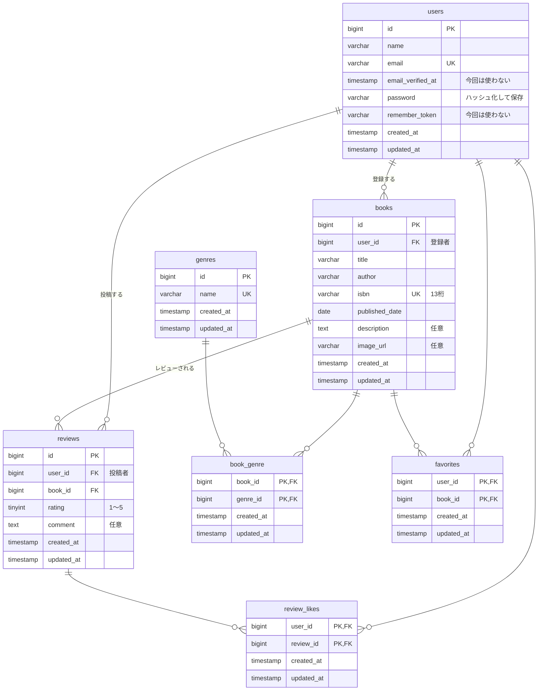

# ER図

アプリのテーブルと、そのつながりを図にしたもの。範囲は基本機能のみ（`docs/features.md` 参照）。
列の型・制約の詳細は `docs/table-definitions.md`、機能ごとのテーブル操作は `docs/crud-matrix.md` を参照。

- 中間テーブルの名前（`book_genre`・`favorites`・`review_likes`）は Q-49 の想定。
- Laravel 標準のテーブル（`password_reset_tokens`・`failed_jobs`・`personal_access_tokens`）は、アプリのテーブルとつながらないため図に入れない。`docs/table-definitions.md` の「Laravel 標準のテーブル」を参照。
- ★応用機能のテーブル（読書計画・通知）は入れない。

## 図

## つながり

| 親       | 子             | 関係         | 意味                                   | 親を削除したとき       | 要件・確認事項 |
| -------- | -------------- | ------------ | -------------------------------------- | ---------------------- | -------------- |
| `users`  | `books`        | 1 対 多      | ユーザーが書籍を登録する               | 削除させない           | DR01、Q-31     |
| `users`  | `reviews`      | 1 対 多      | ユーザーがレビューを投稿する           | 削除させない           | DR04、Q-31     |
| `books`  | `reviews`      | 1 対 多      | 書籍にレビューが付く                   | 一緒に削除（cascade）  | DR04、Q-12     |
| `books`  | `book_genre`   | 多対多の片側 | 書籍とジャンルの紐付け                 | 一緒に削除（cascade）  | DR03、Q-12     |
| `genres` | `book_genre`   | 多対多の片側 | 同上                                   | 削除させない           | DR03、Q-17     |
| `users`  | `favorites`    | 多対多の片側 | ユーザーが書籍をお気に入りにする       | 削除させない           | DR05、Q-31     |
| `books`  | `favorites`    | 多対多の片側 | 同上                                   | 一緒に削除（cascade）  | DR05、Q-12     |
| `users`  | `review_likes` | 多対多の片側 | ユーザーがレビューにいいねする         | 削除させない           | DR06、Q-31     |
| `reviews`| `review_likes` | 多対多の片側 | 同上                                   | 一緒に削除（cascade）  | DR06、Q-12     |

- 「削除させない」は、子の行が残っていると親の行を削除できない（外部キーの既定の動き）。`users` は退会を作らないため削除されない（Q-31）。`genres` は書籍が紐付いていると削除できない（Q-17）。
- 書籍を削除すると、`reviews` が cascade で消え、そのレビューの `review_likes` も続けて cascade で消える（Q-12）。削除のしかたは Q-05。
- 書籍には必ず 1 つ以上のジャンルを付ける（入力チェック、`docs/validation-rules.md`）。DB では 0 件も入れられるため、図では「0 以上」（`o{`）にしている。
- 同じユーザーが同じ書籍に何件でもレビューを書ける（Q-20）ため、`reviews` には `user_id` と `book_id` の組み合わせのユニーク制約を付けない。

## モデルのリレーション

ビューが呼ぶリレーション名（`docs/screen-items.md`「ビューが使うリレーション名」）と、使う中間テーブル。

| モデル   | リレーション名  | 相手     | 種類            | 中間テーブル   |
| -------- | --------------- | -------- | --------------- | -------------- |
| `Book`   | `genres`        | `Genre`  | `BelongsToMany` | `book_genre`   |
| `Book`   | `reviews`       | `Review` | `HasMany`       | －             |
| `Genre`  | `books`         | `Book`   | `BelongsToMany` | `book_genre`   |
| `Review` | `user`          | `User`   | `BelongsTo`     | －             |
| `Review` | `book`          | `Book`   | `BelongsTo`     | －             |
| `Review` | `likedByUsers`  | `User`   | `BelongsToMany` | `review_likes` |
| `User`   | `favoriteBooks` | `Book`   | `BelongsToMany` | `favorites`    |
| `User`   | `likedReviews`  | `Review` | `BelongsToMany` | `review_likes` |

- `favorites`・`review_likes` は Laravel の既定の名前ではないため、`belongsToMany` の第 2 引数にテーブル名を書く。列名（`user_id`・`book_id`・`review_id`）は既定のままで合う。
- 中間テーブルの日時を入れるため、`BelongsToMany` のリレーションには両側とも `withTimestamps()` を付ける。
- ビューが呼ばないリレーションのうち、`Book::user`（`BelongsTo`）は公開API のレスポンスで登録者を返すために使う（Q-27）。ほか（`User` の `books`・`reviews` など）は、実装で必要になったら足す。
