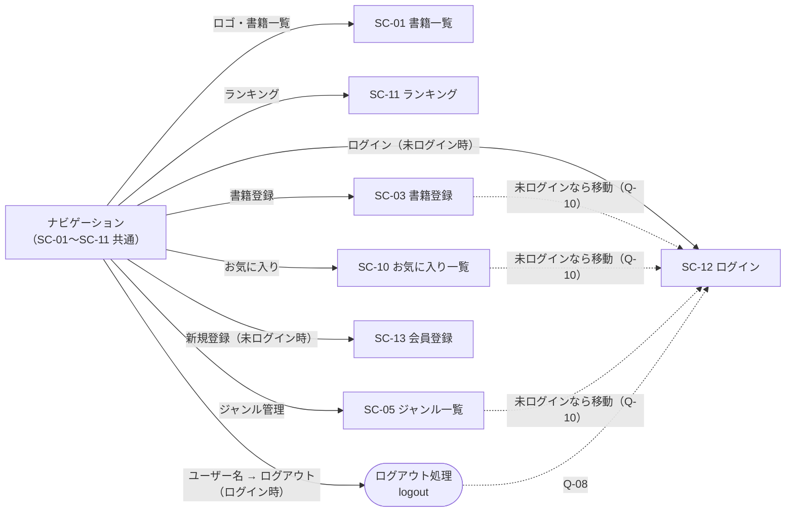
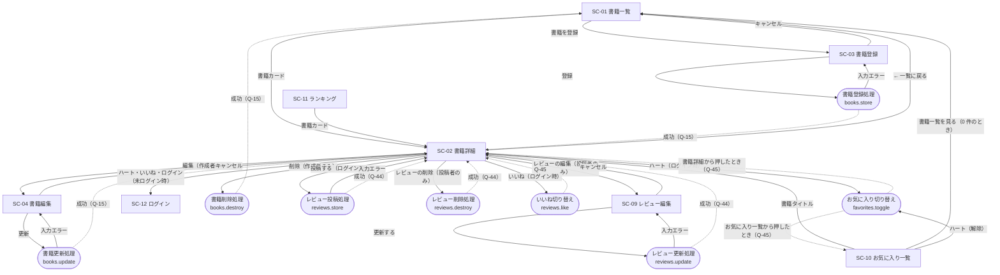
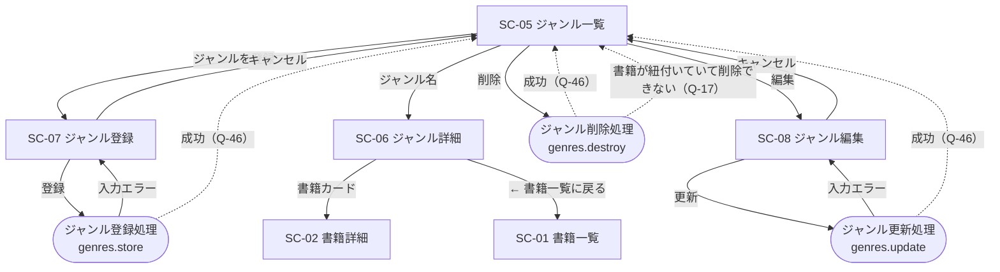
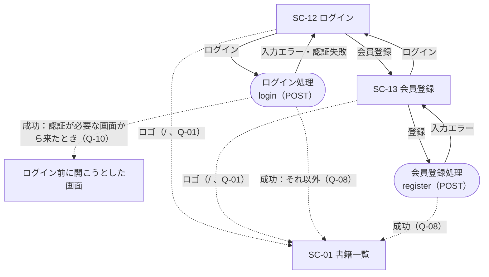

# 画面遷移図

`resources/views/` 配下のビュー（以下「ビュー」）のリンクとフォームの送信先をもとに、画面の移り変わりを図にしたもの。
画面 ID は `docs/screen-list.md` の画面一覧と同じ。範囲は基本機能のみ。

## 図の見かた

| 書き方                      | 意味                                                                     |
| --------------------------- | ------------------------------------------------------------------------ |
| `[SC-xx 画面名]`（四角）    | 画面                                                                     |
| `([処理名])`（角丸）        | 画面を持たない操作（フォームの送信先）                                   |
| 実線 `-->`                  | ビューにリンク・フォームとして書かれている遷移                           |
| 点線 `-.->`                 | ビューに書かれておらず、確認事項（Q-xx）の想定にもとづく遷移             |

- 入力エラーのときは、入力した画面へ戻り、入力値とエラーメッセージを表示する（ビューが `old()` と `@error` / `x-input-error` で表示するため）。
- 削除は、確認ダイアログ（`confirm('本当に削除しますか？')`）で OK を押したときだけ送信する。

## 図1 ナビゲーション

app レイアウトの画面（SC-01〜SC-11）の上部に、共通のナビゲーションがある（`layouts/navigation.blade.php`）。
ログイン状態で出し分けるのは右側のメニューだけで、左側のリンクは常に表示される（Q-10）。

## 図2 書籍・レビュー・お気に入り・ランキング

## 図3 ジャンル

ジャンル詳細の戻るリンクは、ビューのとおりジャンル一覧ではなく書籍一覧へ移動する（`genres/show.blade.php` 11 行目）。

## 図4 ログイン・会員登録

- ゲストレイアウトのロゴのリンク先は `/`（`components/guest-layout.blade.php` 20 行目）。`/` を書籍一覧にするのは Q-01 の想定。
- 書籍詳細のハート・いいね・「ログイン」リンク（未ログイン時）は、`route('login')` への通常のリンク。認証が必要な画面から移動させられたわけではないため、ログイン後は元の書籍詳細ではなく書籍一覧へ移動する（Q-08 の想定どおり）。

## 処理後の移動先

画面を持たない操作の、処理が終わった後の移動先。ビューには移動先が書かれていないため、どれも確認事項の想定。

| 操作               | 成功したとき                          | 失敗したとき                                   | メッセージの表示場所（ビュー）               | 確認事項   |
| ------------------ | ------------------------------------- | ---------------------------------------------- | -------------------------------------------- | ---------- |
| 書籍登録           | SC-02 書籍詳細（登録した書籍）        | 入力エラー：SC-03 へ戻る                       | SC-02 の `session('success')`                | Q-15       |
| 書籍更新           | SC-02 書籍詳細                        | 入力エラー：SC-04 へ戻る                       | SC-02 の `session('success')`                | Q-15       |
| 書籍削除           | SC-01 書籍一覧                        | －                                             | SC-01 の `session('success')`                | Q-15       |
| ジャンル登録       | SC-05 ジャンル一覧                    | 入力エラー：SC-07 へ戻る                       | SC-05 の `session('success')`                | Q-46       |
| ジャンル更新       | SC-05 ジャンル一覧                    | 入力エラー：SC-08 へ戻る                       | SC-05 の `session('success')`                | Q-46       |
| ジャンル削除       | SC-05 ジャンル一覧                    | 書籍が紐付いている：SC-05 へ戻る               | SC-05 の `session('success')`・`session('error')` | Q-46・Q-17 |
| レビュー投稿       | SC-02 書籍詳細                        | 入力エラー：SC-02 へ戻る                       | SC-02 の `session('success')`                | Q-44       |
| レビュー更新       | SC-02 書籍詳細（レビューの書籍）      | 入力エラー：SC-09 へ戻る                       | SC-02 の `session('success')`                | Q-44       |
| レビュー削除       | SC-02 書籍詳細（レビューの書籍）      | －                                             | SC-02 の `session('success')`                | Q-44       |
| いいね切り替え     | SC-02 書籍詳細                        | －                                             | （表示なし。件数とボタンの表示が変わる）     | Q-45       |
| お気に入り切り替え | 押した画面（SC-02 または SC-10）      | －                                             | （表示なし。ハートの表示が変わる）           | Q-45       |
| ログイン           | 開こうとした画面、なければ SC-01      | 入力エラー・認証失敗：SC-12 へ戻る             | SC-12 のメールアドレス欄のエラー             | Q-08・Q-10 |
| 会員登録           | SC-01 書籍一覧（ログイン状態になる）  | 入力エラー：SC-13 へ戻る                       | SC-13 の各項目のエラー                       | Q-08       |
| ログアウト         | SC-12 ログイン                        | －                                             | －                                           | Q-08       |

成功メッセージの文言は、Q-54 で決定済み。

- メッセージは、処理のあとリダイレクトするときにセッションへ入れ、リダイレクト先の画面で 1 回だけ表示する（Laravel のフラッシュデータ）。再読み込みすると消える。
- 表示する場所が無い画面へリダイレクトするときは、メッセージを付けない（付けても誰にも見えないまま消える）。表示する場所があるのは SC-01・SC-02・SC-05 の `session('success')` と、SC-05 の `session('error')` だけ。
- ジャンル一覧（SC-05）では、成功とエラーが同時に出ることは無い（1 回の操作で、どちらか一方だけを付ける）。
- いいね・お気に入りの切り替えは、件数やハートの表示が変わるため、メッセージを付けない。ログイン・会員登録は、ナビゲーションの表示が変わるため、メッセージを付けない。ログアウトは、ログイン画面へ移動するため、メッセージを付けない。

## 認証・認可で移動させられる場合

| 状況                                                         | 移動先                                   | 確認事項 |
| ------------------------------------------------------------ | ---------------------------------------- | -------- |
| 未ログインで、認証が必要な画面（SC-03〜SC-10）を開いた        | SC-12 ログイン（ログイン後は元の画面へ） | Q-10     |
| 作成者以外が SC-04 書籍編集を開いた（URL を直接入力）         | 403 エラー                               | Q-47     |
| 投稿者以外が SC-09 レビュー編集を開いた（URL を直接入力）     | 403 エラー                               | Q-47     |
