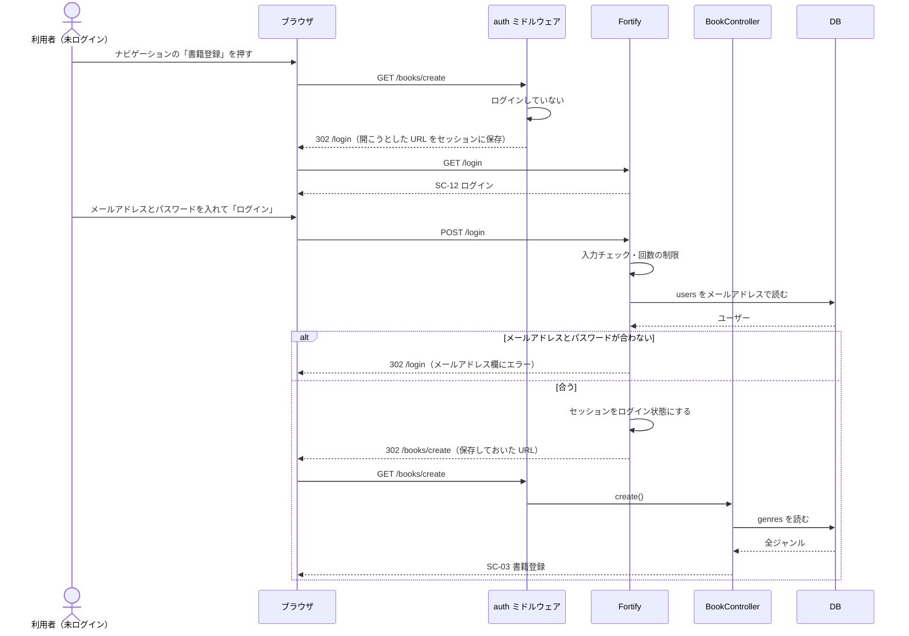
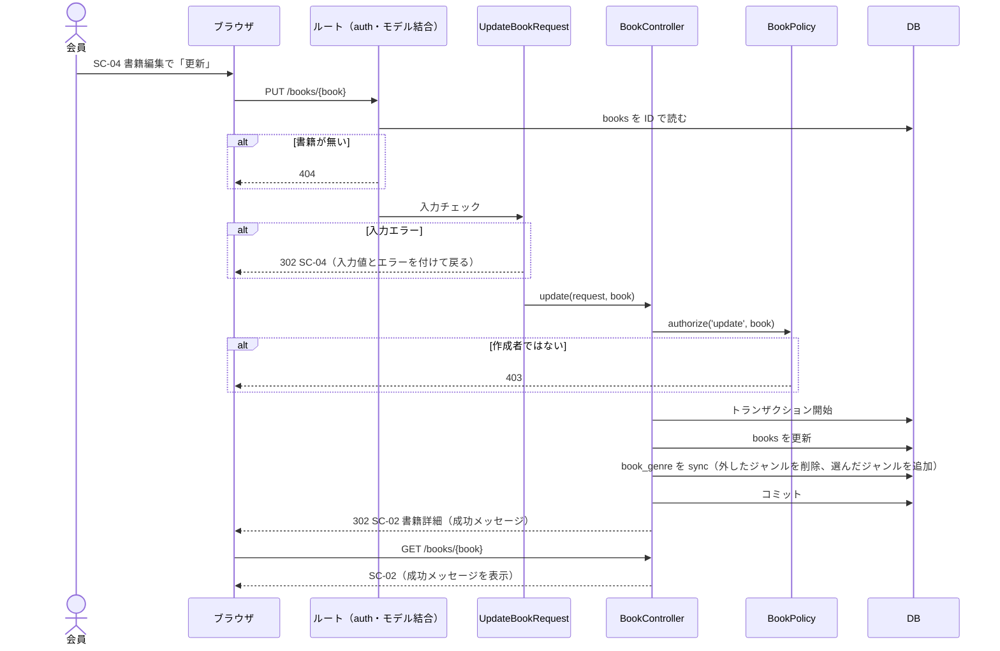
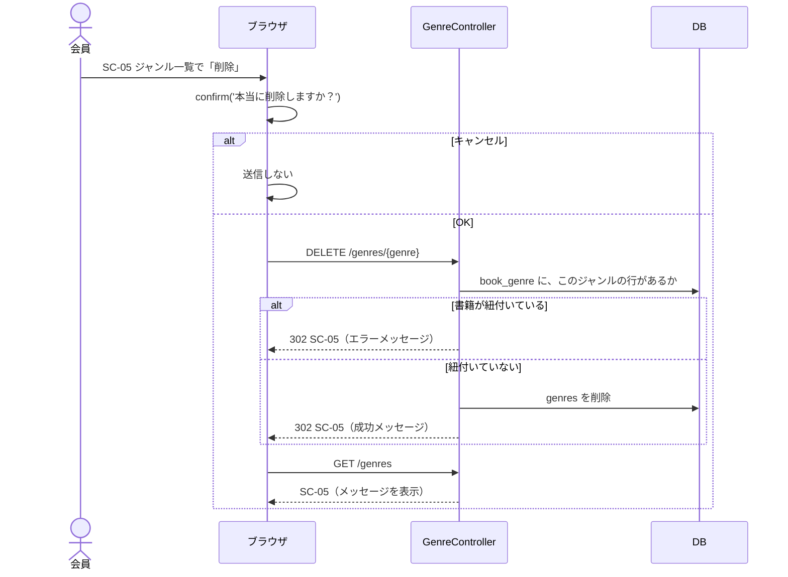
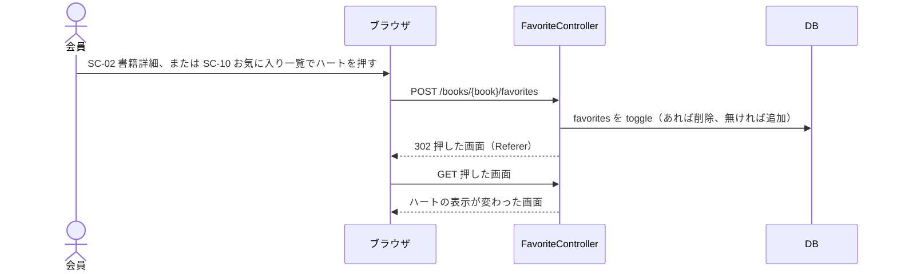
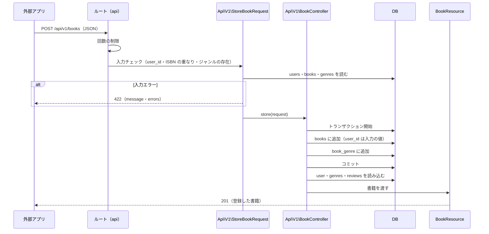

# シーケンス図

代表的な処理の流れを図にしたもの。範囲は基本機能のみ。
クラスの作りは Laravel の MVC の標準のとおり（`docs/routing.md`）。ルートは `docs/routing.md`、エラーの扱いは `docs/error-handling.md` を参照。

## 選んだ処理と理由

全機能を描くと、ほとんどが「入力チェック → 保存 → リダイレクト」の同じ形の繰り返しになる。そこで、ほかの機能と流れが違うところを 1 つずつ持つ処理だけを選んだ。

| 図   | 処理                                       | 機能        | 選んだ理由                                                                                         | 同じ流れになる機能 |
| ---- | ------------------------------------------ | ----------- | -------------------------------------------------------------------------------------------------- | ------------------ |
| 図1  | 未ログインで書籍登録を開き、ログインして戻る | F-03・F-19 | 認証ミドルウェアで止められ、ログイン後に元の画面へ戻る流れ（Q-10）。Fortify が間に入るのはここだけ | 認証が必要な画面すべて |
| 図2  | 書籍更新                                   | F-04        | Web の書き込みに出てくる部品（ルートモデル結合・FormRequest・Policy・トランザクション・成功メッセージ）が、すべてそろう唯一の処理 | F-03・F-09・F-12（部品の一部を使う） |
| 図3  | ジャンル削除                               | F-10        | 入力チェックではなく業務ルールで止め、`session('error')` を出す唯一の処理（Q-17）                 | なし               |
| 図4  | お気に入り切り替え                         | F-15        | 画面に入力も確認ダイアログも無く、押した画面へ戻る切り替えの流れ（Q-45）                          | F-14               |
| 図5  | API 書籍登録                               | F-23        | セッションもリダイレクトも無く、JSON で 201・422 を返す流れ。登録者を入力で受け取る（Q-26）       | F-24（F-21・F-22・F-25 はこの一部） |

### 描かなかった処理

| 処理                                          | 描かなかった理由                                                       |
| --------------------------------------------- | ---------------------------------------------------------------------- |
| 一覧・詳細の表示（F-01・F-02・F-06・F-07・F-16・F-17） | 読んで表示するだけ。読むテーブルは `docs/crud-matrix.md`、集計は `docs/screen-items.md` |
| 書籍登録（F-03）                              | 図2 から Policy と既存データの読み込みを除いたもの                     |
| 書籍削除・レビュー削除（F-05・F-13）          | 図2 の Policy の後に 1 行削除するだけ。関連データは DB の cascade で消える（Q-12） |
| ジャンル登録・編集、レビュー投稿・編集（F-08・F-09・F-11・F-12） | 図2 と同じ形（ジャンルは Policy 無し、レビュー投稿は Policy 無し）      |
| 会員登録・ログアウト（F-18・F-20）            | Fortify の標準の流れのまま。ログアウトの後の移動先だけログイン画面にする（Q-08） |

## 図1 未ログインで書籍登録を開き、ログインして戻る（F-03・F-19）

- 開こうとした URL を保存するのは GET のときだけ（Laravel の標準の動き）。ゲストが画面から押せる POST のボタンは無い（ハート・いいねは、ゲストにはログイン画面へのリンクになる）。
- 保存した URL が無いとき（ナビゲーションの「ログイン」から来たとき）は、書籍一覧へ移動する（Q-08）。

## 図2 書籍更新（F-04）

- 入力チェック（FormRequest）は、コントローラーのメソッドより先に動く。そのため、作成者ではない人が、正しくない入力を送ったときは、403 ではなく入力エラーになる。どちらの場合も保存はされないため、この順番のままにする（Q-52）。
- トランザクションの途中でエラーが起きたときは、`DB::transaction()` がロールバックし、例外をそのまま投げる（500）。書籍の更新だけが残ることは無い（Q-05）。

## 図3 ジャンル削除（F-10）

- 確かめてから削除するまでの間に、別の人がそのジャンルを書籍に紐付けたときは、外部キーで削除が止まり、DB エラー（500）になる。めったに起きないため、特別な扱いはしない（`docs/error-handling.md`）。

## 図4 お気に入り切り替え（F-15）

- 押した画面へ戻るのは `back()` で行う（Q-45）。どちらの画面から押しても、同じルートで処理できる。
- いいね切り替え（F-14）も同じ流れ（`POST /reviews/{review}/like`、`review_likes` を toggle して書籍詳細へ戻る）。

## 図5 API 書籍登録（F-23）

- セッション・CSRF トークン・リダイレクトは使わない。エラーもすべて JSON で返す（`docs/error-handling.md`）。
- 書籍更新（F-24）は、ルートモデル結合（404）が先に入り、`user_id` は任意で、送られたときだけ登録者を変更し（Q-41）、200 を返すところだけが違う。
